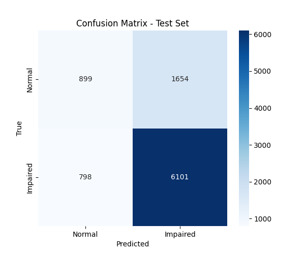
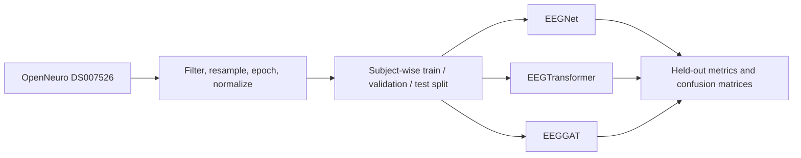

# Alzheimer's EEG Binary Classifier

An experimental comparison of EEGNet, a Transformer, and a graph-attention model for binary classification of resting-state EEG from OpenNeuro DS007526—not a diagnostic or screening device.

## Results

The figures below are from the repository's checked-in experiment reports/artifacts; training and inference were not fully reproduced in this review.

| Model | Reported test accuracy | Impaired precision | Impaired recall |
|---|---:|---:|---:|
| EEGNet | 66.0% | 0.88 | 0.62 |
| EEGTransformer | 74.1% | 0.79 | 0.88 |
| EEGGAT | 65.8% | 0.84 | 0.66 |

The existing results table labels a validation column “Balanced Accuracy,” but the Transformer entry is explicitly described as 75.5% validation accuracy; treat that label as unresolved. The Transformer confusion-matrix artifact implies only 35.2% specificity for the Normal class, so headline accuracy alone overstates the screening story. No clinical utility claim is warranted.



## Architecture



## Quickstart and verification

Dependencies install and `python scripts/train.py --help` worked in the prepared environment. Inference did not: the example's default checkpoint path points outside the cloned repository. The dataset and correctly located checkpoint are prerequisites for a real run.

```bash
python3 -m venv .venv
source .venv/bin/activate
pip install -r requirements.txt
python scripts/train.py --help
```

Request/download OpenNeuro DS007526, follow the preprocessing and split preparation described by the project, then train using the script options. Before using `examples/inference.py`, pass or configure a checkpoint path inside the checkout.

## Limitations

- Small cohort and binary-label construction limit generalization; the dataset includes multiple diagnoses collapsed into “Impaired.”
- Reported specificity is low, and the validation metric naming is inconsistent.
- Checkpoint path assumptions prevent the example inference command from working as cloned.
- This is retrospective dataset classification, not a validated clinical tool.

## Next steps

1. Fix inference to use a CLI checkpoint argument and add a smoke test.
2. Correct the validation metric label and publish exact confusion-matrix counts.
3. Add subject-wise confidence intervals and external-cohort evaluation.
4. Describe the output as research-only and remove screening/clinical-utility language.
